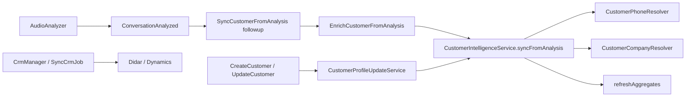

# ممیزی ماژول Contacts & Companies

تاریخ بازرسی: ۱۳ اکتبر ۲۰۲۶. این سند از روی کد موجود نوشته شده و فرض‌های بریف را فقط وقتی تأیید شده‌اند نقل می‌کند.

## پشته

- PHP `^8.3`، Laravel `^13.8`، Livewire `^4.3`، Filament `^5` (پنل ادمین، نه UI مشتریان).
- فرانت محصول: Blade + Livewire + Tailwind CSS v4 + Vite. فونت Vazirmatn. چیدمان RTL در لایه‌های employer و employee.
- صف‌ها: `voip`، `analysis`، `followup`. شنونده مشتری روی `followup` است.
- تست: PHPUnit 12. فرمت: Pint.

مسیر مدیر: پیشوند `/app` و نام `employer.*` در `bootstrap/app.php` و `routes/employer.php`.
مسیر کارشناس: پیشوند `/workspace` و نام `employee.*` در `routes/employee.php`. بریف از `/workspace` درست گفته؛ «agent» در کد `employee` است.

## مدل داده موجود

- شخص: `App\Models\Customer` / جدول `customers`. یکتا روی `(organization_id, normalized_phone)`. مهاجرت `database/migrations/2026_06_15_120000_create_customers_table.php`.
- شرکت: `App\Models\CustomerCompany` / `customer_companies`. یکتا روی `(organization_id, normalized_name)`. مهاجرت `database/migrations/2026_06_21_100000_create_customer_companies_table.php`.
- `customers.customer_company_id` اختیاری، `nullOnDelete`. شرکت `contacts()` دارد.
- `calls.customer_id` اختیاری، `nullOnDelete`.
- هویت تحلیل: `conversation_analyses.customer_identity_json` در `database/migrations/2026_06_14_150000_add_customer_identity_to_conversation_analyses.php`.
- `company_name` روی شخص، نام نمایشی شرکت مرتبط است و همراه `customer_company_id` به‌روز می‌شود. منبع اقتدار رابطه، کلید خارجی است؛ نام، کش نمایشی است.
- Policy لاراول برای مشتری وجود ندارد. مرز مستأجر: `CustomerTenantGuard` و `CustomerCompanyTenantGuard` داخل `mount` کامپوننت‌های Livewire. مدل در `saving` بدون `organization_id` یا کلید یکتا ذخیره نمی‌شود.

## جریان داده فعلی

`SyncCrmJob` و `CrmManager` روی تماس و اتصال CRM کار می‌کنند و جدول `customers` را منبع نوشتن خودشان نمی‌کنند. این ماژول قرارداد آن‌ها را عوض نمی‌کند.

## موجودی رفتار

قابل استفاده مجدد:

- نرمال‌سازی شماره ایران در `CustomerPhoneResolver` (`0912`، `912`، `98`، `0098`).
- ساخت/غنی‌سازی و ادغام رکوردهای همان شماره در `CustomerIntelligenceService`.
- حذف شرکت خود سازمان با `CompanyName::isOwnOrganization`.
- تماس شخصی: شنونده و `syncFromAnalysis` اگر `is_personal` باشد برمی‌گردند.
- لیست، جستجو، مرتب‌سازی، صفحه‌بندی، خروجی xlsx/pdf، فرم ساخت/ویرایش، پروفایل و تایم‌لاین تماس.
- هاب `/app/customers` و `/workspace/customers` با آمار واقعی شرکت، شخص و تماس.
- آستانه اطمینان هویت `0.5` در `CustomerIntelligenceService::MIN_IDENTITY_CONFIDENCE`.

## ریسک‌ها

| شدت | موضوع | مسیر |
| --- | --- | --- |
| بالا | ویرایش انسانی نام، ایمیل، سمت و شرکت با `identity_confidence` موجود قفل نمی‌شد و پیشنهاد جدیدتر با اطمینان بالاتر فیلد را عوض می‌کرد. | `CustomerIntelligenceService::shouldReplaceField` |
| متوسط | `firstOrCreate` شخص در رقابت همزمان ممکن است روی یکتایی شماره بشکند. شرکت از قبل `UniqueConstraintViolationException` را می‌گیرد. | `syncFromAnalysis` |
| متوسط | کارشناس همه اشخاص سازمان را می‌بیند، نه فقط تماس‌های خودش. تحلیل عملکرد کارشناس دیگر در UI محدود است (`CustomerAnalysisVisibility`). این رفتار فعلی محصول است و در این برش عوض نشده. | `Employee/Customers/*` |
| متوسط | آمار `contacts_count` و `total_calls` کش هستند و فقط هنگام refresh به‌روز می‌شوند. | `CustomerCompanyService` |
| پایین | `exists:customer_companies,id` در اعتبارسنجی سراسری است؛ انتساب نهایی دوباره با `organization_id` چک می‌شود. | `CustomerProfileUpdateService` |
| پایین | ادغام تکراری‌های شماره، رکورد تکراری را حذف می‌کند و تماس‌ها را به نگه داشته‌شده منتقل می‌کند. ردپای ادغام جداگانه ندارد. ادغام دستی انبوه پیاده نشده. | `mergeCustomers` |

## API / UI

API جداگانه‌ای برای CRUD مشتری نیست. سطح ارائه Livewire است:

- هاب، لیست اشخاص، لیست شرکت‌ها، ساخت، ویرایش، نمایش شخص، نمایش شرکت.
- خروجی: `CustomerListExportController` برای `contacts` و `companies`.
- هر دو پورتال ویوهای `resources/views/livewire/shared/customers/*` را مشترک دارند. نمایش شخص: `resources/views/livewire/employer/customers/show.blade.php`.

## کوچک‌ترین بهبود سازگار

قفل سطح فیلد با ستون افزایشی `customers.identity_field_sources`، بدون جدول موازی و بدون تغییر یکتایی شماره. رکوردهای قدیمی منبع ندارند و غنی‌سازی قبلی‌شان حفظ می‌شود. ذخیره دستی فرم، فیلدهای هویتی را `human` می‌کند.
