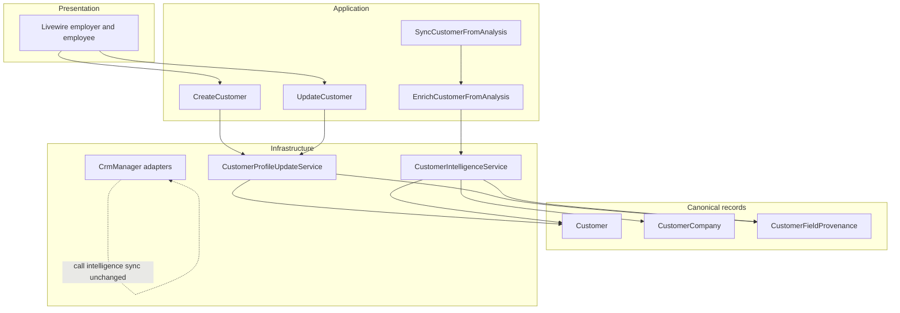

# طراحی Contacts & Companies

## ۱. چیدمان

مسیرهای واقعی، بدون پوشه خالی:

- ارائه: `app/Livewire/Employer/Customers` و `app/Livewire/Employee/Customers`، ویوها در `resources/views/livewire/shared/customers`.
- کاربرد: `app/Application/Customer/Actions` و `app/Application/Customer/Listeners/SyncCustomerFromAnalysis`.
- دامنه موجود: مدل‌های `App\Models\Customer` و `CustomerCompany`. قانون قفل فیلد در `App\Support\CustomerFieldProvenance`.
- زیرساخت باقی‌مانده: `app/Services/CustomerIntelligenceService`، `CustomerProfileUpdateService`، `CustomerPhoneResolver`، `CustomerCompanyResolver`، `CustomerCompanyService`.
- یکپارچه‌سازی بیرونی: `app/Application/Crm` (`CrmManager`، `CrmConnectionResolver`، `SyncCrmJob`). به use case داخلی مشتری وابسته نیست و برعکس.

## ۲. وابستگی

## ۳. ER افزایشی

جدول و کلیدهای موجود دست نخورده‌اند.

- `customers.identity_field_sources` از نوع JSON، nullable، بدون ایندکس (فیلتر لیست روی آن نیست).
- شکل هر فیلد: `{ "source": "human"|"ai", "confidence"?: number, "updated_at": iso8601 }`.
- فیلدهای قفل‌شونده: `name`، `email`، `job_title`، `phone_number`، `company_name`، `customer_company_id`.
- حذف سازمان همچنان `cascade` روی مشتری و شرکت است. حذف شرکت `nullOnDelete` روی شخص. حذف شخص `nullOnDelete` روی `calls.customer_id`. تاریخچه تماس پاک نمی‌شود.

## ۴. اکشن‌ها

| اکشن | مسئولیت | پیاده‌سازی فعلی |
| --- | --- | --- |
| `CreateCustomer` | ساخت دستی داخل سازمان | `CustomerProfileUpdateService::create` |
| `UpdateCustomer` | ویرایش دستی و قفل فیلد | `CustomerProfileUpdateService::update` |
| `EnrichCustomerFromAnalysis` | غنی‌سازی پس از تحلیل | `CustomerIntelligenceService::syncFromAnalysis` |
| تطبیق شماره، پیوند تماس، ادغام معادل‌ها، آمار | داخل همان سرویس هوش، چون رفتار تست‌شده آنجاست | جابه‌جا نشده |
| `CustomerCompanyResolver::findOrCreate` | شرکت با نام نرمال | بدون ادغام مخرب روی شباهت ضعیف؛ تطبیق کلید `CompanyName` |
| `CustomerCompanyService::refreshAggregates` | کش آمار شرکت | پس از تغییر رابطه |

مالک، چرخه عمر، برچسب و یادداشت شخص اضافه نشده‌اند. شرکت از قبل `notes` دارد.

## ۵. مجوز

| عمل | مدیر `/app` | کارشناس `/workspace` |
| --- | --- | --- |
| فهرست و مشاهده اشخاص و شرکت‌های همان سازمان | بله | بله، کل سازمان |
| ساخت و ویرایش شخص و شرکت | بله | بله |
| خروجی لیست | بله | بله |
| دیدن عملکرد کارشناس دیگر در کارت تحلیل | بله | فقط تحلیل خودش |
| سازمان، مالک یا شرکت سازمان دیگر | 404 از guard | 404 از guard |
| ادغام دستی | ندارد | ندارد |

شناسه سازمان از کلاینت پذیرفته نمی‌شود؛ از `EmployerContext` یا `EmployeeContext` می‌آید.

## ۶. صف

- رویداد `ConversationAnalyzed` پس از تحلیل.dispatch می‌شود.
- شنونده `ShouldQueue` با صف `config('queue.names.followup')`، `tries = 3`، `timeout = 120`.
- تماس `is_personal` نادیده گرفته می‌شود.
- کلید منطقی تکرار: `(organization_id, normalized_phone)` و `calls.customer_id`. تحویل دوباره همان تحلیل، شخص دوم نمی‌سازد و تماس را دوباره وصل نمی‌کند اگر از قبل همان `customer_id` باشد.
- رقابت insert روی یکتایی شماره گرفته می‌شود و رکورد موجود خوانده می‌شود.
- شکست صف، وضعیت سینک دیدار/داینامیکس را عوض نمی‌کند.

## ۷. مهاجرت

- مهاجرت افزایشی `2026_10_13_120000_add_identity_field_sources_to_customers`.
- backfill ندارد. رکوردهای قبلی `null` می‌مانند و قانون اطمینان قبلی روی آن‌ها برقرار است.
- بازگشت: drop همان ستون. داده هویتی دیگر پاک نمی‌شود.
- ذخیره دستی بعد از مهاجرت، فیلدهای فرم را human می‌کند؛ از جمله خالی‌هایی که کاربر عمداً خالی گذاشته تا هوش مصنوعی بعداً پرشان نکند.

## ۸. معامله و خارج از محدوده

- معامله، پایپ‌لاین، وظیفه و سازنده گردش‌کار در این ماژول نیستند. امتیاز لید و اقدام بعدی، بینش تحلیل‌اند نه وضعیت معامله.
- مدل موازی `crm_contacts` ساخته نشده.
- ادغام انبوه تولیدی اجرا نمی‌شود.
- چند روش تماس به‌جای یکتایی شماره جایگزین نشده؛ شماره همچنان قرارداد هویت است.
- دید کارشناس به کل مشتریان سازمان حفظ شده تا مسیر فعلی `/workspace` نشکند.
