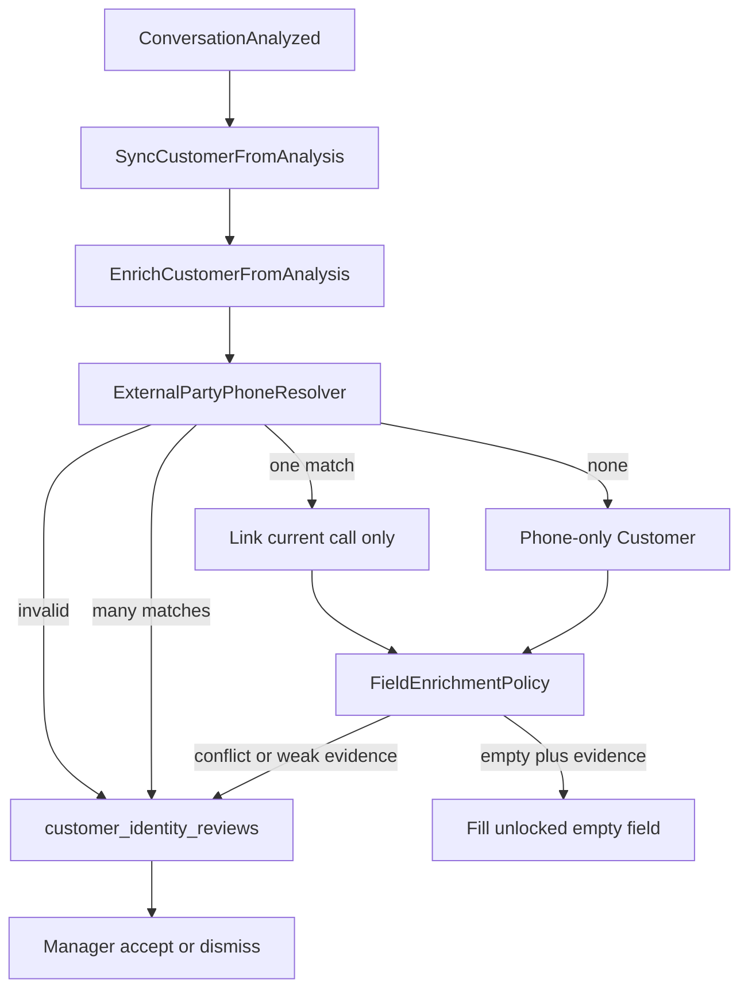
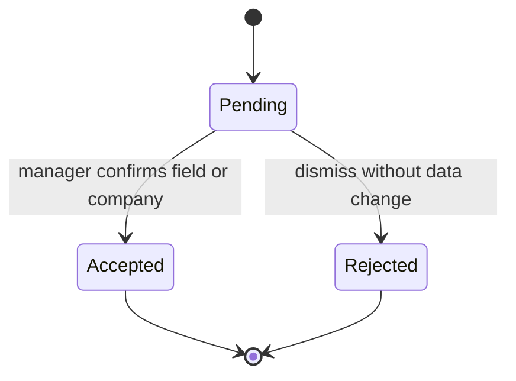

# طراحی هویت قابل‌اعتماد

## ADR

شماره، شخص نیست و خروجی مدل حقیقت قطعی نیست. امن‌ترین مسیر سازگار با کلید فعلی این است:

- شماره معتبر طرف بیرونی، حداکثر یک رکورد شماره‌محور provisional بسازد.
- اگر بیش از یک رکورد برای شکل‌های معادل همان شماره باشد، هیچ‌کدام حذف نشود و تماس وصل نشود.
- نام، ایمیل و سمت فقط وقتی فیلد خالی است و شاهد متنی به «مشتری گفت» یا «مشتری:» اشاره دارد و اطمینان حداقل همان ۰٫۵ قبلی را دارد، پر شود. این آستانه به‌تنهایی کافی نیست.
- نام موجود، حتی اگر دستی قفل نشده باشد، با مدل عوض نشود. تعارض به `customer_identity_reviews` می‌رود.
- شرکت از تحلیل ساخته یا وصل نشود. پیشنهاد در صف بررسی می‌ماند تا مدیر تأیید کند.
- شماره نامعتبر، داخلی، یا متعلق به شماره داخلی سازمان، مشتری نمی‌سازد.
- ادغام مخرب و بازانتساب تاریخچه اجرا نمی‌شود.

مدل آینده (اجرا نشد): جدول `contact_phone_identifiers` برای چند شماره و شماره مشترک، بعد از برداشتن یکتایی فعلی. هزینه آن مهاجرت داده و ریسک شکستن `calls.customer_id` است. تا وقتی صف بررسی و قفل فیلد کافی است، کلید یکتا باقی می‌ماند.

## جریان

## ER افزایشی

`customer_identity_reviews`: سازمان، شخص و تماس و تحلیل اختیاری، `kind`، `field`، مقدار فعلی و پیشنهادی، شاهد حداکثر ۲۴۰ نویسه، `status`، `context` بدون متن کامل مکالمه. یکتا روی `(conversation_analysis_id, kind, field)`. حذف تحلیل، ردیف بررسی را `nullOnDelete` می‌کند. بازگشت مهاجرت: drop همین جدول. ستون `identity_field_sources` از قبل هست و backfill نشد؛ رکورد قدیمی verified جعل نمی‌شود.

## تقدم فیلد

| فیلد | منبع خودکار | تقدم |
| --- | --- | --- |
| شماره | متادیتای تماس | ساخت provisional. شماره مدل کلید نیست |
| نام، ایمیل، سمت | فقط پر کردن خالی با شاهد مشتری | مقدار موجود و قفل انسانی نمی‌شکند |
| شرکت | هیچ‌وقت خودکار | تأیید مدیر، آن هم اگر نام سازمان خودتان نباشد |
| امتیاز لید | آمار تحلیل | جدا از اطمینان هویت |

## API / UI

صفحه Livewire مدیر: `/app/customers/reviews`. کارشناس همان فهرست را در `/workspace/customers/reviews` فقط می‌بیند و دکمه تأیید ندارد. تأیید فیلد یا شرکت در تراکنش انجام می‌شود. بستن مورد، داده مشتری را عوض نمی‌کند. مورد شماره تکراری دکمه ادغام ندارد.

## خارج از این گام

پاک‌سازی اشخاصی که قبلاً با ادغام حذف شده‌اند، بازنویسی `normalized_name`، و اتصال دوباره تماس‌های قدیمی. برای آن‌ها گزارش فقط‌خواندنی جدا لازم است و در این گام روی داده تولید اجرا نشد.
